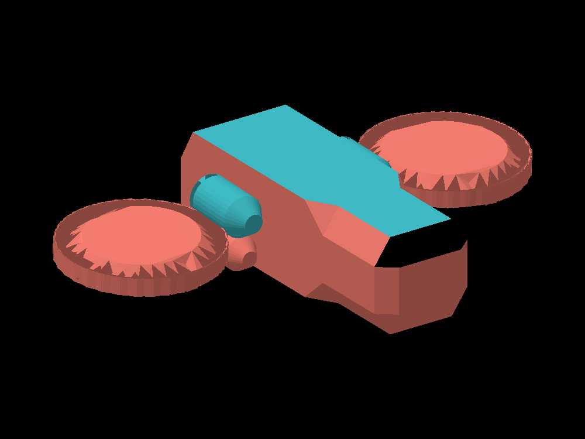

# Nave: renderer de triangulos en C++

Este proyecto carga `Nave.obj`, obtiene los vertices de cada cara y dibuja los
triangulos con un rasterizador propio. SDL2 muestra el framebuffer en una ventana.
El modelo se centra y se ajusta automaticamente al 82% de la pantalla.



**Esta imagen es una vista de referencia generada con una implementacion auxiliar
en Python. No es una captura de un ejecutable C++ verificado.** Para tu entrega,
compila tu programa, guarda su imagen y reemplaza la imagen de este README por
`render.png`, usando ``.

## Archivos

- `main.cpp`: ventana SDL, teclado y vista inicial.
- `obj_loader.h`: lectura del OBJ y reglas para identificar las partes.
- `geometry.h`: vertices, triangulos y operaciones de vectores.
- `renderer.h`: framebuffer, profundidad, proyeccion y funcion `triangle`.
- `colors.h`: colores editables y excepciones por cara.
- `Nave.obj`: copia del modelo original, sin modificar su geometria.
- `ppm_a_png.py`: convierte la imagen del programa a PNG sin instalar paquetes.

## Colores y partes

El OBJ tiene los nombres `Cylinder`, `Cylinder.001` y `Cube`. No tiene nombres
especificos para el vidrio y el techo, ni materiales que los distingan.
`assignParts` separa componentes conectados y clasifica superficies por posicion
y orientacion. Estas reglas se ajustaron a ESTE archivo; si lo editas o lo vuelves
a exportar, revisalas.

| Nombre en el codigo | Parte asignada | Color inicial |
|---|---|---|
| `Body` | Paredes y base del cuerpo | Salmon |
| `LeftTurbine` | Turbina del lado Z negativo del OBJ | Salmon |
| `RightTurbine` | Turbina del lado Z positivo del OBJ | Salmon |
| `LowerCylinders` | Conectores inferiores | Salmon |
| `UpperCylinders` | Cilindros superiores | Teal |
| `Roof` | Superficies horizontales de arriba | Teal |
| `Window` | Bisel superior del frente, extremo X positivo | Negro puro |

La identificacion del vidrio es una interpretacion visual del modelo, no una
etiqueta de Blender. Si te referias a otra zona, cambia la regla comentada
en `assignParts` o asigna colores directamente a sus caras.
El fondo de la ventana de SDL tambien es negro puro.

## Como cambiar los colores

Abre `colors.h`. Cada color tiene tres componentes: rojo, verde y azul, de 0 a 255.

```cpp
inline constexpr Color SALMON{250, 128, 114};
inline constexpr Color TEAL{64, 190, 200};
```

Cambiar `SALMON` cambia todas las partes que lo usan. Para cambiar solo el cuerpo,
modifica su linea dentro de `colorForPart`, por ejemplo:

```cpp
case Part::Body: return Color{220, 100, 80};
```

Para hacer solo los cilindros superiores azul celeste:

```cpp
case Part::UpperCylinders: return Color{135, 206, 235};
```

Para cambiar solo una de las turbinas:

```cpp
case Part::LeftTurbine: return Color{255, 140, 100};
```

Para pintar una cara especifica, agrega una entrada en `FACE_COLORS`:

```cpp
inline const std::map<int, Color> FACE_COLORS = {
    {2283, Color{255, 255, 0}},
};
```

El ID es la posicion de la linea `f` dentro de todas las caras del OBJ, contando
desde 1; no es el numero de linea del archivo ni un indice de vertice.
`caras_por_parte.txt` lista los IDs identificados en este modelo.
Las excepciones de `FACE_COLORS` tienen prioridad sobre el color de la pieza.
Cuando una superficie tiene dos triangulos, cambia ambos para pintarla completa.

La iluminacion oscurece algunos triangulos para mostrar el volumen. Si quieres
que TODOS usen exactamente el RGB elegido, cambia en `colors.h`:

```cpp
inline constexpr bool USE_LIGHTING = false;
```

Despues de editar archivos C++, vuelve a compilar.

## Como funciona el dibujo

1. `loadOBJ` lee las posiciones de las lineas `v` y los indices de las lineas `f`.
2. Un token `12/3/5` utiliza el `12` para buscar la posicion del vertice. El indice
   positivo se resta en uno porque OBJ empieza en 1 y los vectores de C++ en 0.
3. `assignParts` etiqueta las caras para elegir sus colores.
4. `render` gira las posiciones y hace una proyeccion ortografica a la pantalla.
   La coordenada Y se invierte porque en la imagen aumenta hacia abajo.
5. El bucle final obtiene los tres vertices de CADA triangulo usando sus indices.
6. `Framebuffer::triangle` recorre pixeles del rectangulo que contiene el triangulo.
   Usa coordenadas baricentricas para decidir cuales estan dentro e interpolar Z.
7. El buffer de profundidad permite que una cara cercana tape una cara lejana.
8. SDL copia el framebuffer a la ventana. No usa funciones de SDL para dibujar
   triangulos ni un motor 3D para renderizar el modelo.

Tu OBJ ya tiene 2414 caras triangulares. Hay 1232 vertices declarados y algunos
no se usan en las caras; se excluyen del calculo del encuadre.

**Para tu laboratorio:** el enunciado pide usar *tu funcion para pintar triangulos*.
Esta version incluye una implementacion de ejemplo para que el proyecto sea
autonomo. Si ya tienes `triangle.h`, `framebuffer.h` y `color.h` del curso, adapta
el bucle final de `render` a esas funciones y usa el mismo framebuffer para las
pruebas de profundidad. Revisa con lo visto en clase la parte que debes reutilizar.

## Compilar y ejecutar con ventana

Requisitos: compilador C++17, CMake y SDL2 para la misma arquitectura del compilador.
Si SDL2 ya esta disponible para CMake, desde esta carpeta:

```text
cmake -S . -B build
cmake --build build --config Release
```

Si CMake no encuentra SDL2, indica la carpeta que contiene `SDL2Config.cmake`:

```text
cmake -S . -B build -DSDL2_DIR="C:/ruta/a/SDL2/cmake"
```

En Windows con un generador como Visual Studio, ejecuta desde la carpeta del proyecto:

```text
.\build\Release\nave.exe .\Nave.obj
```

Con un generador de una sola configuracion, el ejecutable suele quedar en
`build/nave.exe` (Windows) o `build/nave` (Linux). Si usas SDL2 dinamico en Windows,
su `SDL2.dll` debe estar junto al ejecutable o disponible en PATH.

En Linux, con SDL2 y `pkg-config` disponibles, tambien puedes compilar directamente:

```sh
g++ -std=c++17 main.cpp -o nave $(pkg-config --cflags --libs sdl2)
./nave Nave.obj
```

No se necesita GLM en esta version: `geometry.h` contiene las operaciones pequenas
de vectores utilizadas. Tampoco se necesita cargar el MTL: los colores estan en C++.

## Controles y PNG para tu entrega

- Flechas: girar la nave.
- R: volver a la vista inicial.
- S: guardar `render.ppm` en la carpeta desde la que ejecutaste el programa.
- Esc: salir.

Despues de presionar S, convierte la imagen con Python:

```text
python ppm_a_png.py render.ppm render.png
```

Sube `render.png` junto con el codigo y el OBJ a tu repositorio, y actualiza el
enlace de la imagen del README. PPM es solo el formato intermedio; la entrega pide PNG o JPG.

Para cambiar la vista inicial, edita `yaw` y `pitch` en `main.cpp`. Para cambiar el
tamano en pantalla, edita el factor `0.82f` en `renderer.h`.

## Alternativa sin ventana ni SDL

Con un compilador C++17 puedes ejecutar el mismo rasterizador y exportar su imagen:

```text
cmake -S . -B build-headless -DHEADLESS=ON
cmake --build build-headless --config Release
```

En Windows con Visual Studio:

```text
.\build-headless\Release\nave.exe Nave.obj render.ppm
python ppm_a_png.py render.ppm render.png
```

En Linux tambien sirve `g++ -std=c++17 -DHEADLESS main.cpp -o nave` y luego
`./nave Nave.obj render.ppm`. Para el ejercicio que muestra una ventana SDL,
usa la version con ventana.

## Verificacion realizada

Se revisaron las caras y los indices del OBJ; se genero e inspecciono visualmente
la vista de referencia con el modelo centrado; se verifico la conversion PPM a PNG
comparando los pixeles. No se compilo ni ejecuto este proyecto C++ en el entorno
de preparacion porque no hay compilador C++ ni SDL2 configurados. La compilacion
y la ventana deben verificarse en tu entorno del laboratorio.
