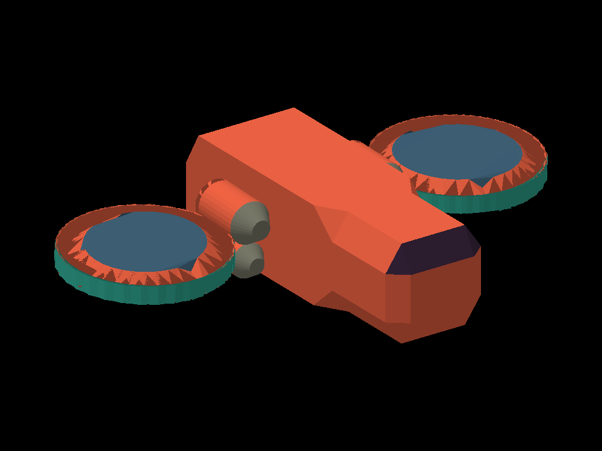

# Nave: renderer de triangulos en C++

Este proyecto carga `Nave.obj`, obtiene los vertices de cada cara y dibuja los
triangulos con un rasterizador propio. SDL2 muestra el framebuffer en una ventana.
El modelo se centra y se ajusta automaticamente al 82% de la pantalla.




## Archivos

- `main.cpp`: ventana SDL, teclado y vista inicial.
- `obj_loader.h`: lectura del OBJ y reglas para identificar las partes.
- `geometry.h`: vertices, triangulos y operaciones de vectores.
- `renderer.h`: framebuffer, profundidad, proyeccion y funcion `triangle`.
- `colors.h`: colores editables y excepciones por cara.
- `Nave.obj`: copia del modelo original, sin modificar su geometria.
- `ppm_a_png.py`: convierte la imagen del programa a PNG sin instalar paquetes.

| Nombre en el codigo | Parte asignada | Color inicial |
|---|---|---|
| `Body` | Paredes y base del cuerpo | Naranja rojizo |
| `LeftTurbine` | Dientes inclinados de la turbina Z negativo | Naranja rojizo |
| `RightTurbine` | Dientes inclinados de la turbina Z positivo | Naranja rojizo |
| `TurbineRim` | Pared exterior de ambas turbinas | Turquesa |
| `TurbineCore` | Disco interior de ambas turbinas | Gris azulado oscuro |
| `LowerCylinders` | Conectores inferiores | Naranja rojizo |
| `UpperCylinders` | Capsulas de los motores | Naranja rojizo |
| `Nozzle` | Cono y tapa frontal de los cilindros (toberas) | Gris |
| `Roof` | Superficies horizontales de arriba | Naranja rojizo |
| `Window` | Frente visto como cuadricula 3x3: filas 1-2-3 y 4-5-6 | Morado oscuro |
| `RidgeFront` | Salidita de arriba: punta delantera | Turquesa |
| `RidgeMiddle` | Salidita de arriba: anillo intermedio | Gris |
| `RidgeBack` | Salidita de arriba: caja trasera | Naranja rojizo |


## Como funciona el dibujo

1. `loadOBJ` lee las posiciones de las lineas `v` y los indices de las lineas `f`.
2. Un token `12/3/5` utiliza el `12` para buscar la posicion del vertice. El indice
   positivo se resta en uno porque OBJ empieza en 1 y los vectores de C++ en 0.
3. `assignParts` etiqueta las caras para elegir sus colores.
4. `render` gira las posiciones y hace una proyeccion ortografica a la pantalla.
   La coordenada Y se invierte porque en la imagen aumenta hacia abajo.
5. El bucle final obtiene los tres vertices de CADA triangulo usando sus indices.
6. `Framebuffer::triangle` recorre pixeles del rectangulo que contiene el triangulo.
   Usa coordenadas baricentricas para decidir cuales estan dentro e interpolar Z.
7. El buffer de profundidad permite que una cara cercana tape una cara lejana.
8. SDL copia el framebuffer a la ventana. No usa funciones de SDL para dibujar
   triangulos ni un motor 3D para renderizar el modelo.

Tu OBJ ya tiene 2414 caras triangulares. Hay 1232 vertices declarados y algunos
no se usan en las caras; se excluyen del calculo del encuadre.

**Para tu laboratorio:** el enunciado pide usar *tu funcion para pintar triangulos*.
Esta version incluye una implementacion de ejemplo para que el proyecto sea
autonomo. Si ya tienes `triangle.h`, `framebuffer.h` y `color.h` del curso, adapta
el bucle final de `render` a esas funciones y usa el mismo framebuffer para las
pruebas de profundidad. Revisa con lo visto en clase la parte que debes reutilizar.

## Compilar y ejecutar con ventana

**En este equipo:** doble clic en `NaveRenderer/compilar.bat` y luego en
`NaveRenderer/abrir_nave.bat`. Si la nave sigue abierta, `compilar.bat` la cierra
sola antes de recompilar (Windows no deja reemplazar un `.exe` abierto).

En otro equipo: compilador C++17, CMake y SDL2 para la misma arquitectura del
compilador. Si SDL2 ya esta disponible para CMake, desde `NaveRenderer`:

```text
cmake -S . -B build
cmake --build build --config Release
```

Si CMake no encuentra SDL2, indica la carpeta REAL que contiene `SDL2Config.cmake`
(la ruta de abajo es solo un ejemplo; si la copias tal cual, la compilacion falla):

```text
cmake -S . -B build -DSDL2_DIR="C:/ruta/a/SDL2/cmake"
```

En Windows con un generador como Visual Studio, ejecuta desde la carpeta del proyecto:

```text
.\build\Release\nave.exe .\Nave.obj
```

Con un generador de una sola configuracion, el ejecutable suele quedar en
`build/nave.exe` (Windows) o `build/nave` (Linux). Si usas SDL2 dinamico en Windows,
su `SDL2.dll` debe estar junto al ejecutable o disponible en PATH.

En Linux, con SDL2 y `pkg-config` disponibles, tambien puedes compilar directamente:

```sh
g++ -std=c++17 main.cpp -o nave $(pkg-config --cflags --libs sdl2)
./nave Nave.obj
```

## Verificacion realizada

El proyecto se compilo con `compilar.bat` (clang++ de llvm-mingw + SDL2 2.32) y la
ventana SDL abre correctamente. `render.png` se genero con la version sin ventana
del mismo codigo.
